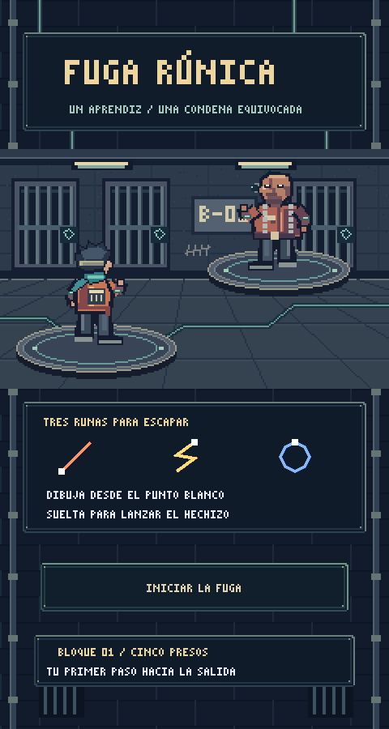

# Fuga Rúnica — prototipo de PokerVS

Juego 2D de magia para Android en vertical. Eres un aprendiz encarcelado por un malentendido que busca escapar de una prisión moderna atravesada por magia. Godot **4.7 estable**, sin complementos ni recursos externos. Abre `project.godot` en el editor y pulsa **F6** en `scenes/main.tscn`, o **F5** para ejecutar el proyecto.

## Cómo jugar

Al abrir el juego, mira las tres páginas de la introducción y pulsa **CONTINUAR** al terminar cada una. Después, en la celda animada, pulsa **INICIAR**. Dibuja un solo trazo en el panel inferior, comenzando en el punto blanco de la referencia del HUD, y levanta el dedo para lanzar. En computadora usa el botón izquierdo del ratón. El tamaño y la posición del dibujo pueden variar; la orientación y el sentido deben seguir la referencia. Un toque o un trazo demasiado corto no lanza hechizos.

Las tres tarjetas superiores muestran tus gestos y su recarga. El enemigo ataca automáticamente cuando termina su cuenta atrás; el tiempo sigue corriendo mientras dibujas. El escudo absorbe daño y el hielo detiene temporalmente la cuenta atrás.

| Hechizo | Gesto | Efecto | Recarga |
| --- | --- | --- | --- |
| Fuego | Diagonal ascendente hacia la derecha | 28 daño | 1,4 s |
| Rayo | Zigzag descendente | 42 daño | 2,8 s |
| Escudo | Círculo horario desde arriba | +24 barrera, máximo 48 | 4 s |
| Curación | V desde arriba a la izquierda | +26 vida, máximo 100 | 6 s |
| Hielo | V invertida desde abajo a la izquierda | 16 daño y congela 2,5 s | 3 s |
| Explosión | L desde arriba a la izquierda | 60 daño | 5 s |

Empiezas con fuego, rayo y escudo. Cada victoria otorga monedas y recupera 12 de vida. En el refugio selecciona uno de los tres espacios y compra uno de los tres hechizos ofrecidos, o abre **Mis runas** para equipar uno que ya posees. Los precios dependen de la calidad. Equipar un hechizo que ya llevas intercambia los espacios. Puedes salir de la tienda sin comprar. La primera etapa completa cubre los niveles 1–15 del bloque de celdas. Todos los rivales son presos. Mazas (5) y La Cerrajera (10) son élites; El Síndico (15) es el jefe. Hay tienda entre combates y la victoria de etapa aparece únicamente tras derrotar al jefe. La tienda se presenta como contrabando entre presos.


Las monedas y los hechizos comprados pertenecen a la partida actual. Reiniciar o cerrar el juego los borra. No hay todavía metaprogresión ni guardado.

## Estructura

- `scenes/main.tscn`: escena de entrada; genera los botones de menú y tienda.
- `scripts/main.gd`: combate, HUD, dibujo táctil, tienda y estados de la partida. Escenarios y personajes pixel art originales; efectos dibujados sobre una rejilla de píxeles.
- `scenes/battle_arena.tscn`: fondo, aprendiz de espaldas y rival de frente, con sprites filtrados por vecino más cercano.
- `scripts/battle_arena.gd`: poses, cola de lanzamientos, impactos y efectos para cada hechizo.
- `scripts/battle_hud.gd`: información del rival y cuenta atrás sobre el escenario.
- `assets/pixel/`: sprites y escenario PNG originales.
- `scripts/campaign.gd`: estructura de 5 etapas × 15 niveles, facciones y los quince encuentros del bloque.
- `scripts/gestures.gd`: reconocimiento por remuestreo de 32 puntos y comparación con los hechizos equipados. Umbral configurable en `recognize`.
- `tests/smoke.gd`: pruebas de reconocimiento y del flujo de una partida completa.

Los gestos se definen en `templates()`. `scripts/spells.gd` centraliza nombres, calidades, precios, probabilidades, daño, recargas, colores y familias de poses; `main.gd` aplica los efectos adicionales. Al ampliar el catálogo, mantén alineados los IDs de las plantillas y del catálogo. Los números actuales son de prueba, no un balance definitivo.

## Validación en la nube

```bash
export XDG_CACHE_HOME=/workspace/.cache
export XDG_DATA_HOME=/workspace/.local/share
export XDG_CONFIG_HOME=/workspace/.config
cd /workspace/PokerVS
/workspace/.tools/godot-4.7/Godot_v4.7-stable_linux.x86_64 --headless --path . --editor --import
/workspace/.tools/godot-4.7/Godot_v4.7-stable_linux.x86_64 --headless --path . --script res://tests/smoke.gd
/workspace/.tools/godot-4.7/Godot_v4.7-stable_linux.x86_64 --headless --path . --script res://tests/spells.gd
/workspace/.tools/godot-4.7/Godot_v4.7-stable_linux.x86_64 --headless --path . --quit-after 120
```

En otra máquina sustituye la ruta del ejecutable por tu Godot 4.7. Estas comprobaciones no sustituyen las pruebas de pantalla y tacto en un teléfono.

## Probar en Android

1. Abre el proyecto en Godot 4.7 e instala las plantillas de exportación de esa misma versión desde el editor.
2. Configura OpenJDK 17 y Android SDK según la documentación de exportación Android de Godot. Define sus rutas en los ajustes del editor.
3. En **Proyecto → Exportar**, añade un destino Android, establece un identificador de paquete propio y exporta un APK de depuración. No necesitas modificar escenas para pasar de ratón a tacto: está activada la emulación de ratón desde la pantalla táctil.
4. Instala el APK en tu teléfono o usa el despliegue con USB y depuración USB habilitada.
5. Verifica los dieciséis gestos a distintas velocidades, las tres tarjetas en pantalla y los costes de magia negra, las tiendas, las recargas, la derrota y la victoria. Comprueba especialmente márgenes y legibilidad en tu modelo.

La ventana lógica es de 480 × 900, orientación vertical y proporción conservada; otras pantallas pueden mostrar bandas. Se usa el renderizador Compatibility para este prototipo 2D. No se ha generado ni probado un APK en este entorno y no se incluyen credenciales de firma.

## Pendiente de diseño

Validar comodidad del dibujo en Android antes de ampliar el catálogo. Después: enemigos con patrones propios, efectos y sonido, práctica de gestos, pausa, ajustes de accesibilidad, equilibrio, progresión permanente y guardado.

## Campaña acordada y alcance actual

| Etapa | Sector | Rivales |
| --- | --- | --- |
| 1 | Bloque de celdas | Presos |
| 2 | Patio y talleres | Presos |
| 3 | Complejo de seguridad | Guardias |
| 4 | Distrito penitenciario | Guardias especializados |
| 5 | Umbral de salida | Seguridad de élite |

Cada etapa tiene 15 niveles: élites en 5 y 10, jefe en 15. `PrisonCampaign.location()` describe los 75 puestos de la campaña; los primeros quince tienen encuentros implementados y accesibles. Los demás requieren enemigos, escenarios y balance propios antes de habilitarse. Mazas y La Cerrajera son élites; El Síndico es el jefe del bloque.

Dirección visual provisional: hormigón, barrotes, fluorescentes y cámaras con lentes rúnicas; uniformes y magia de contrabando. Personajes y fondo usan pixel art original: hojas de 11 poses por personaje y escenario de 240 × 148 píxeles, ampliados sin suavizado (aprendiz a 3×; rivales y escenario a 2×). El título «Fuga Rúnica» es provisional. La introducción muestra en viñetas el incidente que lleva al aprendiz a prisión; el resto de la historia se insinúa con frases breves.

## Vista de combate y animaciones

La composición usa al aprendiz de espaldas, abajo a la izquierda, y al preso de frente, arriba a la derecha. Se inspira en la disposición de los combates clásicos de Pokémon; los personajes y escenarios son originales de este proyecto. Se mantienen el combate en tiempo real y los tres hechizos equipados.

Cada hechizo tiene una pose de preparación, un gesto propio, un efecto y recuperación. Los rivales también usan los gestos correspondientes a sus ataques. Los lanzamientos rápidos se encolan para que ninguno pierda su animación. El golpe final termina de reproducirse antes de cambiar de pantalla; el resultado del combate se calcula al aceptar el hechizo, igual que en el prototipo anterior.

| Hechizo | Gesto de manos |
| --- | --- |
| Fuego | Una palma abierta hacia el rival |
| Rayo | Índice elevado para canalizar el rayo |
| Escudo | Antebrazos cruzados delante del cuerpo |
| Curación | Manos juntas cerca del pecho |
| Hielo | Dos dedos extendidos y brazo de apoyo |
| Explosión | Ambos brazos abiertos, palmas elevadas |

Los PNG están incluidos y Godot no necesita Python para ejecutar el juego. Para editar/regenerar los sprites, modifica `tools/build_pixel_assets.py` y ejecútalo con Python 3 y Pillow. Cada celda mide 64 × 72; las columnas son reposo, respiración, preparación, fuego, rayo, escudo, curación, hielo, explosión, impacto y derrota. Los quince presos tienen paletas y accesorios propios (mohicano, abrigo remendado, capucha, cadenas, máscara, auriculares y hombreras).

La nueva vista se verificó con renderizado OpenGL por software y capturas de los seis hechizos. Sigue pendiente probar esta revisión en un teléfono Android real.


[Ver la pose y el efecto de Rayo](docs/lightning.png).

## Interfaz pixel art y corrección de brazos

Toda la interfaz comparte la fuente bitmap original `RuneCompact`, con acentos y signos españoles. Menú, tienda, victoria, derrota y HUD usan marcos de metal, botones y fondos pixelados, además de un icono y una pantalla de inicio propios. Las fuentes se dibujan a escalas enteras y los símbolos y trazos visibles se ajustan a una rejilla de 2 píxeles; el reconocimiento sigue usando las coordenadas originales del dedo.

El aprendiz se compone por capas: primero los brazos que llegan hacia delante y luego el torso, la cabeza y la bufanda que los ocultan en la vista de espaldas. La preparación, el escudo y la curación tienen poses adaptadas a esa perspectiva. Los enemigos de frente conservan el orden inverso. Una regresión de píxeles comprueba que las siete poses de lanzamiento no pinten encima del parche de la espalda.

Para regenerar los recursos: `python3 tools/build_pixel_assets.py` y `python3 tools/build_pixel_font.py` (requieren Pillow). `scripts/pixel_ui.gd` centraliza la tipografía y los marcos; `assets/pixel/ui_theme.tres` aplica el mismo tema a los controles. No se necesitan estas herramientas para jugar.

[Menú actualizado](docs/menu.png) · [Tienda](docs/shop.png) · [Pose de escudo corregida](docs/shield.png).

## Menú animado y tutorial

El menú ocupa toda la ventana de juego con una celda pixel art original. El aprendiz está sentado en la cama detrás de las rejas, con los brazos cruzados. Un bucle de 12 segundos combina respiración del cuerpo, movimiento independiente de cabeza, miradas laterales y parpadeos. Tres goteras forman gotas, caen y salpican; sus ciclos coinciden al cerrar el bucle.

El título aparece arriba a la izquierda, **INICIAR** abajo a la derecha y **CÓMO JUGAR** abajo a la izquierda. El tutorial tiene tres páginas de instrucciones sobre dibujo, combate y compra/equipamiento, sin contenido narrativo. La celda continúa animada mientras se consulta; iniciar una partida oculta la escena y detiene su actualización.

- `scenes/menu_cell.tscn` y `scripts/menu_cell.gd`: capas del escenario, poses y gotas.
- `scripts/menu_ui.gd`: título e instrucciones ilustradas.
- `tools/build_menu_assets.py`: regenera los cuatro PNG del menú con Python 3 y Pillow; no es necesario para jugar.

Se comprobaron el renderizado real en Godot, las páginas del tutorial, los botones, el cierre del bucle y la detención al iniciar. Sigue pendiente comprobarlo en un teléfono físico.



[Ver el tutorial](docs/tutorial.png).

## Primera etapa completa

| Nivel | Preso | Comportamiento |
| --- | --- | --- |
| 1 | Cobrador del pasillo | Fuego de 12 |
| 2 | Chispa | Rayos rápidos de 9 |
| 3 | La Remendadora | Barrera inicial de 20 |
| 4 | Tiza | Dos pulsos de 8 |
| 5 | Mazas — élite | Alterna 16/26; furia a media vida |
| 6 | Brasa | Fuego de 15 cada 3,6 s |
| 7 | La Aguja | Dos pulsos de 10 |
| 8 | Vaho | Barrera inicial de 32 |
| 9 | El Zurcidor | Dos ataques de 13 y una curación de 24 |
| 10 | La Cerrajera — élite | Alterna 18/30; furia a media vida |
| 11 | Ceniza | Alterna fuego de 19 y explosión de 25 |
| 12 | Eco | Dos pulsos de 12 |
| 13 | La Muralla | Barrera inicial de 48; golpes de 22 |
| 14 | Sutura | Dos ataques de 17 y una curación de 24 |
| 15 | El Síndico — jefe | Fuego 18, barrera 24, rayo 20 y explosión 32; furia a media vida |

Las curaciones y barreras consumen un turno sin causar daño. El HUD anuncia la acción siguiente. En furia los élites y el jefe reducen sus intervalos un 30 %. El hielo pausa su cuenta atrás. La barrera del jefe tiene un máximo de 48 y los sanadores no superan su vida inicial.

La victoria concede `35 + nivel × 5` monedas, más 20 en niveles 5, 10 y 15, y recupera hasta 12 de vida. Las tiendas conservan las compras y tres espacios de hechizos durante los 15 combates. Completar el bloque no abre todavía la segunda etapa. El equilibrio es provisional y requiere pruebas de dibujo en Android.

[El Síndico en combate](docs/boss.png).

## Calidades, ofertas y diez hechizos nuevos

La tienda sortea **tres hechizos distintos que todavía no posees**, una sola vez tras cada victoria que lleva a una tienda. Cambiar de espacio, comprar o abrir **Mis runas** no renueva las ofertas. Una compra queda en esa tarjeta como equipable hasta el próximo combate; no puedes pagarla dos veces. Si quedan menos de tres hechizos sin comprar, se muestran los restantes; si tienes todos, se indica que la colección está completa. **Mis runas** pagina los hechizos adquiridos, de tres en tres, para equiparlos gratis. Sigues llevando exactamente tres y sin duplicados.

| Calidad | Peso de aparición | Precio |
| --- | --- | --- |
| Común | 60 | 35 |
| Raro | 24 | 55 |
| Especial | 10 | 85 |
| Legendario | 5 | 120 |
| Magia negra | 1 | 150 |

Para cada oferta se elige primero una calidad y luego un hechizo uniforme dentro de ella. Los pesos equivalen a 60/24/10/5/1 % cuando las cinco calidades tienen candidatos. Se excluyen los hechizos poseídos y los ya sorteados en esa tienda; al agotarse una calidad, se renormalizan los pesos restantes. No son porcentajes por tienda completa ni garantías de conseguir una calidad.

Los iniciales Fuego y Escudo son comunes; Rayo, Curación e Hielo son raros; Explosión es especial. Las nuevas runas son:

| Hechizo | Calidad | Gesto (desde el punto blanco) | Efecto | Recarga |
| --- | --- | --- | --- | --- |
| Roca | Común | Triángulo desde abajo a la izquierda | 22 daño | 1 s |
| Viento | Común | Z desde arriba a la izquierda | 18 daño y frena 0,6 s | 1,8 s |
| Brote | Raro | M desde abajo a la izquierda | +18 vida y +12 barrera | 5 s |
| Lanza | Raro | > desde arriba a la izquierda | 60 daño, ignora la barrera | 4 s |
| Glaciar | Especial | W desde arriba a la izquierda | 28 daño y frena 4 s | 6 s |
| Trueno | Especial | N desde abajo a la izquierda | 90 daño | 6 s |
| Égida | Legendario | Rombo horario desde arriba | +48 barrera y +20 vida | 9 s |
| Meteoro | Legendario | Cuadrado horario desde arriba a la izquierda | 140 daño | 9 s |
| Sangre | Magia negra | Estrella de cinco puntas desde arriba | 220 daño; sacrifica 34 vida | 12 s |
| Vacío | Magia negra | Espiral cuadrada hacia dentro | 180 daño; parálisis propia de 3 s | 10 s |

Todos se dibujan en un solo trazo. Los nuevos lanzamientos reutilizan las seis familias de gestos de manos, con colores propios y su runa pixelada al impactar. La vida no supera 100 y la barrera no supera 48. Lanza ignora la barrera enemiga sin consumirla. Las congelaciones no acortan una congelación más larga que siga activa.

**Sangre** cuesta un tercio de la vida máxima, redondeado hacia arriba: 34 puntos cada lanzamiento. La barrera no absorbe este coste. Puede matarte; si ambos caen al mismo tiempo, pierdes y no cobras la victoria. **Vacío** bloquea nuevos dibujos y lanzamientos durante 3 segundos; los enemigos y las recargas siguen avanzando. El HUD muestra la cuenta atrás y las runas bloqueadas. Los efectos negativos se limpian al cambiar de combate o reiniciar. Ambos costes aparecen en las tarjetas de compra y en **Mis runas**.

`tests/spells.gd` comprueba el catálogo nuevo, las compras, el inventario, el agotamiento de ofertas, 20.000 sorteos con semilla fija y los efectos secundarios. Los valores y probabilidades son configurables y el equilibrio sigue pendiente de pruebas en Android físico.

[Magia negra durante un combate](docs/black_magic.png).

## Introducción en viñetas

La apertura sigue tres páginas y ocho viñetas, de arriba hacia abajo:

1. Llegada a la ciudad, paso por el callejón y sorpresa del aprendiz.
2. Dos policías junto al civil muerto, descubrimiento del testigo y preparación del aprendiz para combatir.
3. Un policía lanza magia maldita; el aprendiz impacta contra el muro y se desploma.

La dirección visual comparte la cuadrícula de 240 píxeles, los colores planos y las proporciones del menú. Se reutilizan el sprite del aprendiz y la cabeza de la celda. Fondos, policías y movimientos se dibujan directamente en Godot con rectángulos, polígonos y líneas sin suavizado; no se usan ilustraciones detalladas ni imágenes generadas en la introducción.

Cada viñeta aparece mediante un fundido de 0,8 segundos, con 3 segundos entre comienzos. Las anteriores permanecen visibles. El botón **CONTINUAR** solo aparece 1,2 segundos después de completar la última viñeta, y la página espera indefinidamente al jugador. Los cambios de página tienen un fundido a negro y de regreso, de 0,5 segundos por tramo. La última transición revela la celda animada; **INICIAR** se habilita al terminar y comienza el primer combate. Durante la introducción no funcionan el dibujo ni los controles de combate. Reintentar una partida no repite la cinemática; volver a abrir el juego sí.

- `scenes/intro.tscn` y `scripts/intro.gd`: revelado, máscaras diagonales, botón y transiciones.
- `scripts/intro_panel.gd`: escenarios y personajes de las ocho viñetas, pasos, sobresalto, conjuro e impacto/caída.
- `tests/intro.gd`: orden de aparición, bloqueo de avance prematuro y doble pulsación, fundidos y llegada al menú y al combate.

Prueba adicional: `godot --headless --path . --script res://tests/intro.gd` (sustituye `godot` por la ruta de tu ejecutable Godot 4.7). Se revisaron capturas de las tres páginas y de la transición final con OpenGL; queda pendiente validar en Android físico.

[Primera página](docs/intro1.png) · [Segunda página](docs/intro2.png) · [Tercera página](docs/intro3.png).
