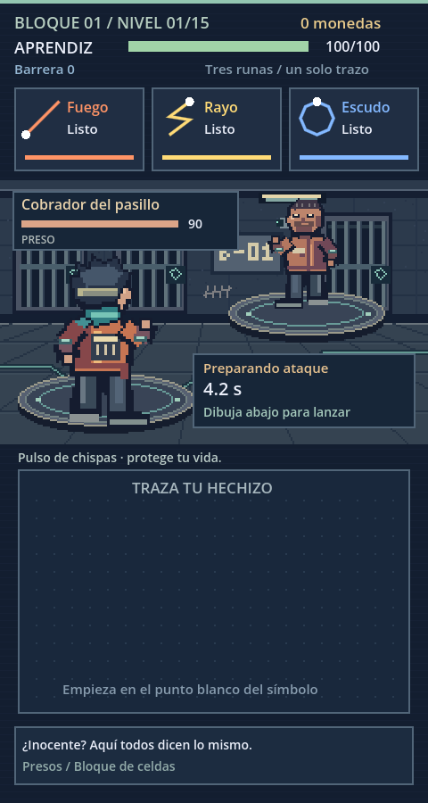

# Fuga Rúnica — prototipo de PokerVS

Juego 2D de magia para Android en vertical. Eres un aprendiz encarcelado por un malentendido que busca escapar de una prisión moderna atravesada por magia. Godot **4.7 estable**, sin complementos ni recursos externos. Abre `project.godot` en el editor y pulsa **F6** en `scenes/main.tscn`, o **F5** para ejecutar el proyecto.

## Cómo jugar

Pulsa **Iniciar la fuga**. Dibuja un solo trazo en el panel inferior, comenzando en el punto blanco de la referencia del HUD, y levanta el dedo para lanzar. En computadora usa el botón izquierdo del ratón. El tamaño y la posición del dibujo pueden variar; la orientación y el sentido deben seguir la referencia. Un toque o un trazo demasiado corto no lanza hechizos.

Las tres tarjetas superiores muestran tus gestos y su recarga. El enemigo ataca automáticamente cuando termina su cuenta atrás; el tiempo sigue corriendo mientras dibujas. El escudo absorbe daño y el hielo detiene temporalmente la cuenta atrás.

| Hechizo | Gesto | Efecto | Recarga |
| --- | --- | --- | --- |
| Fuego | Diagonal ascendente hacia la derecha | 28 daño | 1,4 s |
| Rayo | Zigzag descendente | 42 daño | 2,8 s |
| Escudo | Círculo horario desde arriba | +24 barrera, máximo 48 | 4 s |
| Curación | V desde arriba a la izquierda | +26 vida, máximo 100 | 6 s |
| Hielo | V invertida desde abajo a la izquierda | 16 daño y congela 2,5 s | 3 s |
| Explosión | L desde arriba a la izquierda | 60 daño | 5 s |

Empiezas con fuego, rayo y escudo. Cada victoria otorga monedas y recupera 12 de vida. En el refugio selecciona uno de los tres espacios y compra un hechizo por 35 monedas, o equipa uno que ya posees. Equipar un hechizo que ya llevas intercambia los espacios. Puedes salir de la tienda sin comprar. Esta demo cubre los niveles 1–5 del bloque de celdas: Cobrador del pasillo, Chispa, La Remendadora, Tiza y Mazas (élite). Son presos, no guardias. El último combate cierra la demo, no la etapa ni la historia completa. Mazas alterna un golpe de 16 con otro de 26 de daño, y acelera por debajo de la mitad de su vida. La Remendadora empieza con 20 de barrera y Tiza ataca con dos pulsos. La tienda se presenta como contrabando entre presos.

Las monedas y los hechizos comprados pertenecen a la partida actual. Reiniciar o cerrar el juego los borra. No hay todavía metaprogresión ni guardado.

## Estructura

- `scenes/main.tscn`: escena de entrada; genera los botones de menú y tienda.
- `scripts/main.gd`: combate, HUD, dibujo táctil, tienda y estados de la partida. Escenarios y personajes pixel art originales; efectos dibujados sobre una rejilla de píxeles.
- `scenes/battle_arena.tscn`: fondo, aprendiz de espaldas y rival de frente, con sprites filtrados por vecino más cercano.
- `scripts/battle_arena.gd`: poses, cola de lanzamientos, impactos y efectos para cada hechizo.
- `scripts/battle_hud.gd`: información del rival y cuenta atrás sobre el escenario.
- `assets/pixel/`: sprites y escenario PNG originales.
- `scripts/campaign.gd`: estructura de 5 etapas × 15 niveles, facciones y los cinco encuentros iniciales.
- `scripts/gestures.gd`: reconocimiento por remuestreo de 32 puntos y comparación con los hechizos equipados. Umbral configurable en `recognize`.
- `tests/smoke.gd`: pruebas de reconocimiento y del flujo de una partida completa.

Los gestos se definen en `templates()`. Para ampliar el catálogo habrá que mantener sincronizados sus datos y efectos en `main.gd`; conviene separarlos en recursos cuando crezca el prototipo. Los números actuales son de prueba, no un balance definitivo.

## Validación en la nube

```bash
export XDG_CACHE_HOME=/workspace/.cache
export XDG_DATA_HOME=/workspace/.local/share
export XDG_CONFIG_HOME=/workspace/.config
cd /workspace/PokerVS
/workspace/.tools/godot-4.7/Godot_v4.7-stable_linux.x86_64 --headless --path . --editor --import
/workspace/.tools/godot-4.7/Godot_v4.7-stable_linux.x86_64 --headless --path . --script res://tests/smoke.gd
/workspace/.tools/godot-4.7/Godot_v4.7-stable_linux.x86_64 --headless --path . --quit-after 120
```

En otra máquina sustituye la ruta del ejecutable por tu Godot 4.7. Estas comprobaciones no sustituyen las pruebas de pantalla y tacto en un teléfono.

## Probar en Android

1. Abre el proyecto en Godot 4.7 e instala las plantillas de exportación de esa misma versión desde el editor.
2. Configura OpenJDK 17 y Android SDK según la documentación de exportación Android de Godot. Define sus rutas en los ajustes del editor.
3. En **Proyecto → Exportar**, añade un destino Android, establece un identificador de paquete propio y exporta un APK de depuración. No necesitas modificar escenas para pasar de ratón a tacto: está activada la emulación de ratón desde la pantalla táctil.
4. Instala el APK en tu teléfono o usa el despliegue con USB y depuración USB habilitada.
5. Verifica los seis gestos a distintas velocidades, las tres tarjetas en pantalla, las tiendas, las recargas, la derrota y la victoria. Comprueba especialmente márgenes y legibilidad en tu modelo.

La ventana lógica es de 480 × 900, orientación vertical y proporción conservada; otras pantallas pueden mostrar bandas. Se usa el renderizador Compatibility para este prototipo 2D. No se ha generado ni probado un APK en este entorno y no se incluyen credenciales de firma.

## Pendiente de diseño

Validar comodidad del dibujo en Android antes de ampliar el catálogo. Después: enemigos con patrones propios, efectos y sonido, práctica de gestos, pausa, ajustes de accesibilidad, equilibrio, progresión permanente y guardado.

## Campaña acordada y alcance actual

| Etapa | Sector | Rivales |
| --- | --- | --- |
| 1 | Bloque de celdas | Presos |
| 2 | Patio y talleres | Presos |
| 3 | Complejo de seguridad | Guardias |
| 4 | Distrito penitenciario | Guardias especializados |
| 5 | Umbral de salida | Seguridad de élite |

Cada etapa tiene 15 niveles: élites en 5 y 10, jefe en 15. `PrisonCampaign.location()` describe los 75 puestos de la campaña; solo los primeros cinco tienen encuentros implementados y accesibles. Los demás requieren enemigos, escenarios y balance propios antes de habilitarse. Mazas es un élite del nivel 5, no el jefe del bloque.

Dirección visual provisional: hormigón, barrotes, fluorescentes y cámaras con lentes rúnicas; uniformes y magia de contrabando. Personajes y fondo usan pixel art original: hojas de 11 poses por personaje y escenario de 240 × 148 píxeles, ampliados sin suavizado (aprendiz a 3×; rivales y escenario a 2×). El título «Fuga Rúnica» es provisional. La historia se insinúa con frases breves, sin cinemáticas.

## Vista de combate y animaciones

La composición usa al aprendiz de espaldas, abajo a la izquierda, y al preso de frente, arriba a la derecha. Se inspira en la disposición de los combates clásicos de Pokémon; los personajes y escenarios son originales de este proyecto. Se mantienen el combate en tiempo real y los tres hechizos equipados.

Cada hechizo tiene una pose de preparación, un gesto propio, un efecto y recuperación. Los rivales también usan los gestos correspondientes a sus ataques. Los lanzamientos rápidos se encolan para que ninguno pierda su animación. El golpe final termina de reproducirse antes de cambiar de pantalla; el resultado del combate se calcula al aceptar el hechizo, igual que en el prototipo anterior.

| Hechizo | Gesto de manos |
| --- | --- |
| Fuego | Una palma abierta hacia el rival |
| Rayo | Índice elevado para canalizar el rayo |
| Escudo | Antebrazos cruzados delante del cuerpo |
| Curación | Manos juntas cerca del pecho |
| Hielo | Dos dedos extendidos y brazo de apoyo |
| Explosión | Ambos brazos abiertos, palmas elevadas |

Los PNG están incluidos y Godot no necesita Python para ejecutar el juego. Para editar/regenerar los sprites, modifica `tools/build_pixel_assets.py` y ejecútalo con Python 3 y Pillow. Cada celda mide 64 × 72; las columnas son reposo, respiración, preparación, fuego, rayo, escudo, curación, hielo, explosión, impacto y derrota. Los cinco presos tienen siluetas y detalles distintos (mohicano, abrigo remendado, capucha, cadenas).

La nueva vista se verificó con renderizado OpenGL por software y capturas de los seis hechizos. Sigue pendiente probar esta revisión en un teléfono Android real.



[Ver la pose y el efecto de Rayo](docs/lightning.png).
